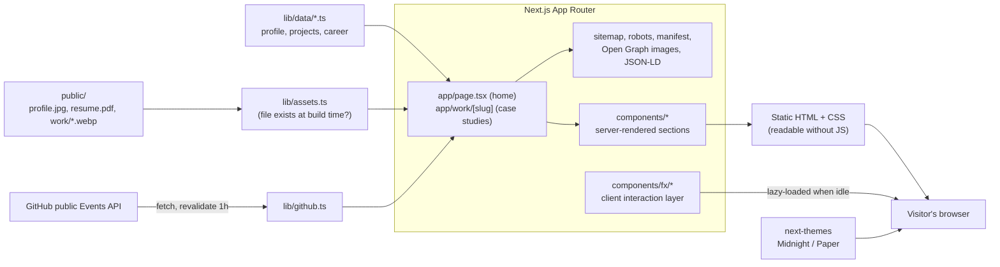

# suriyaprakashrm.dev

Personal portfolio of **Suriya Prakash R M**: an AI and software engineering student's work, career and projects, presented as a fast, statically generated Next.js site with two complete visual editions and an optional interactive layer.

Site URL (configured in [`package.json`](package.json) and [`lib/data/profile.ts`](lib/data/profile.ts)): <https://www.suriyaprakashrm.dev>

   

## Overview

A portfolio has to work for two very different readers: a recruiter who skims for thirty seconds, and an engineer who wants to see how projects were actually built. This site serves both:

- The **home page** gives the short version: headline, featured work, a "lab" grid of smaller projects, experience, skills, achievements and contact details.
- Each featured project has its own **case-study page** (`/work/<slug>`) covering the problem, the approach, highlights, architecture and results.
- An **interaction layer** (terminal, experiments, pointer effects) is there for visitors who want to explore, but it is loaded only after the page is idle and every section stays readable without JavaScript.

All content lives in typed data files under [`lib/data/`](lib/data), so the site, the résumé and the GitHub profile can be kept telling the same story without touching component code.

## Key features

- **Two editions, one codebase**: *Midnight* (dark, default) and *Paper* (light, editorial), switched with a toggle and persisted by `next-themes`. Paper-only fonts are not preloaded, so Midnight visitors never download them.
- **Case-study pages** for the featured projects (DrivePortz, TrackIt, SepsisSense), statically generated with `generateStaticParams`. Projects with a live site show a real screenshot from [`public/work/`](public/work); projects without one show their architecture as a pipeline instead of a fake UI ([`components/project-visual.tsx`](components/project-visual.tsx)).
- **The lab**: a filterable grid of further GitHub projects defined in [`lib/data/projects.ts`](lib/data/projects.ts).
- **Live GitHub pulse**: the hero shows "last commit ... in <repo>", fetched from the public GitHub Events API and revalidated at most once an hour (ISR). If GitHub is unreachable, it is simply hidden ([`lib/github.ts`](lib/github.ts)).
- **Skill usage on hover**: each skill chip shows which projects use it, computed from the project stacks, so it updates itself when projects change.
- **Interactive extras** (code-split and mounted on idle by [`components/fx/deferred-fx.tsx`](components/fx/deferred-fx.tsx)):
  - Hero dot field that reacts to the cursor; clicking sends a ripple.
  - "What happens if I try this?" button that cycles through experiments: Blueprint (an X-ray of the components), Break (and rebuild), Gravity, and a hidden terminal.
  - A terminal opened with `Ctrl/Cmd + K` or the nav icon. Commands include `help`, `whoami`, `ls`, `open <project>`, `loop`, `skills`, `experience`, `awards`, `resume`, `theme`, `ship`, `sudo hire suriya`.
  - Typewriter roles in the hero (they deliberately mistype and correct themselves).
  - "How I build" orbit in the About section, where each step links to a real project story.
  - Konami code (Up Up Down Down Left Right Left Right B A) or the terminal's `ship` command triggers confetti.
- **SEO and sharing**: per-page metadata, a generated Open Graph image (site-wide and per case study), schema.org `Person`/`WebSite`/`CreativeWork` JSON-LD, `sitemap.xml`, `robots.txt`, a web manifest and a generated Apple touch icon.
- **Security headers** (`X-Content-Type-Options`, `Referrer-Policy`, `X-Frame-Options`, `Permissions-Policy`, HSTS) and a friendly download filename for the résumé, configured in [`next.config.mjs`](next.config.mjs).
- **Accessibility and performance**: motion respects `prefers-reduced-motion`, scroll reveals are CSS-only, continuous animations pause off-screen, and Vercel Analytics is only rendered when running on Vercel.

## Architecture



| Component | Role |
| --- | --- |
| `lib/data/` | Single source of truth for all content: profile and links, featured case studies and lab projects, experience, education, skills, achievements and certifications. |
| `lib/assets.ts` | Checks at build time whether `public/profile.jpg` and `public/resume.pdf` exist. Without a photo an "SP" monogram is shown; without a résumé the résumé buttons are hidden. |
| `lib/github.ts` | Fetches the most recent public push event for the GitHub user, skipping the profile-README repo. Returns `null` on any failure so the site never depends on GitHub. |
| `app/` | Routes and metadata: the home page, the case-study route, Open Graph image generation, icons, sitemap, robots and manifest. |
| `components/` | One server component per home page section (hero, featured work, lab, about, experience, skills, recognition, contact), plus header, footer and theme toggle. |
| `components/fx/` | Client-only interaction layer: hero field, pointer effects (spotlight, magnetic, tilt), count-up, text scramble, experiments, terminal and confetti. Loaded with `next/dynamic` once the browser is idle or on first interaction. |
| `app/globals.css` | Design tokens for both editions (`:root, .paper` for Paper and `.dark` for Midnight) and the Paper-specific `pp-*` hook classes. |

## How it works

1. **Build**: Next.js renders the home page and one page per featured project (`generateStaticParams` over `featuredProjects`, with `dynamicParams = false`). Content comes from `lib/data/*`, and `lib/assets.ts` decides whether to render the photo and résumé.
2. **GitHub pulse**: the home page is revalidated at most once an hour (`export const revalidate = 3600`). On revalidation, `getLatestPush()` calls `https://api.github.com/users/suriyaprakash-25/events/public` and picks the latest `PushEvent`.
3. **First paint**: the visitor receives server-rendered HTML styled for the Midnight edition (the `dark` class is set on `<html>`), so the page is correct before and without JavaScript. Scroll reveals are pure CSS.
4. **Hydration**: `next-themes` restores the visitor's saved edition (Midnight or Paper). `DeferredFx` waits for an idle callback, or the first key or pointer event, and only then loads the pointer effects, experiments and terminal bundles.
5. **Sharing**: when a link is shared, crawlers read the per-page metadata, the JSON-LD, and the Open Graph image generated by `app/opengraph-image.tsx` (or the per-project variant under `app/work/[slug]/`).

## Tech stack

| Layer | Technologies |
| --- | --- |
| Framework | Next.js 16 (App Router, ISR, `next/og`, `next/font`), React 19 |
| Language | TypeScript 5 |
| Styling | Tailwind CSS v4 (`@tailwindcss/postcss`), CSS design tokens, `clsx` + `tailwind-merge` |
| Theming | `next-themes` (Midnight and Paper editions) |
| Icons | `lucide-react` |
| Fonts | Geist, Geist Mono, Bricolage Grotesque, JetBrains Mono (via `next/font/google`) |
| Data | Typed TypeScript modules in `lib/data/`, GitHub public REST API |
| Analytics | `@vercel/analytics` (enabled only on Vercel) |

## Project structure

```text
portfolio/
├── app/
│   ├── layout.tsx              # Root layout: fonts, metadata, theme provider, header/footer, deferred fx
│   ├── page.tsx                # Home page: all sections + Person JSON-LD, hourly revalidation
│   ├── work/[slug]/            # Case-study pages and their Open Graph images
│   ├── opengraph-image.tsx     # Generated 1200x630 share card
│   ├── apple-icon.tsx, icon.svg, manifest.ts, sitemap.ts, robots.ts, not-found.tsx
│   └── globals.css             # Tokens for both editions, Paper hooks, reveal animations
├── components/
│   ├── hero.tsx, featured-work.tsx, lab.tsx, about.tsx, experience.tsx,
│   │   skills.tsx, recognition.tsx, contact.tsx   # Home page sections
│   ├── project-visual.tsx      # Screenshot frame or architecture pipeline for a project
│   ├── site-header.tsx, site-footer.tsx, theme-toggle.tsx, theme-provider.tsx
│   └── fx/                     # Interaction layer (terminal, experiments, pointer fx, confetti, ...)
├── lib/
│   ├── data/profile.ts         # Name, headline, links, hero stats, roles, build loop
│   ├── data/projects.ts        # Featured case studies and lab projects
│   ├── data/career.ts          # Experience, education, skills, achievements, certifications
│   ├── github.ts               # Latest public push (ISR, fails silently)
│   ├── assets.ts               # Build-time checks for photo and résumé
│   └── structured-data.ts      # schema.org JSON-LD
├── public/
│   ├── profile.jpg, resume.pdf
│   └── work/                   # Project screenshots (.webp)
├── next.config.mjs             # Security headers, image formats, résumé headers
└── AGENTS.md, .github/copilot-instructions.md   # Notes for AI coding assistants
```

## Getting started

### Prerequisites

- Node.js (a version supported by Next.js 16; Node 20 or newer is recommended)
- npm

### Install and run

```bash
npm install
npm run dev        # http://localhost:3000
```

| Script | What it does |
| --- | --- |
| `npm run dev` | Start the development server |
| `npm run build` | Create a production build |
| `npm run start` | Serve the production build |
| `npm run typecheck` | Type-check the project with `tsc --noEmit` |

There are no required environment variables. `VERCEL` is set automatically by Vercel and only controls whether Vercel Analytics is rendered.

### Add your photo and résumé

| What | Where | Notes |
| --- | --- | --- |
| Profile photo | `public/profile.jpg` | 4:5 portrait or square, at least 800px wide. Until it exists an "SP" monogram is shown. |
| Résumé | `public/resume.pdf` | "Résumé" buttons appear automatically once the file exists. |

Rebuild (or restart `npm run dev`) after adding either file, because their presence is checked at build time.

### Edit content

All content lives in [`lib/data/`](lib/data); edit it there, not inside components.

- [`profile.ts`](lib/data/profile.ts): headline, intro, links, hero stats, typewriter `roles` (keep each 20 characters or fewer), the `buildLoop` and About copy.
- [`projects.ts`](lib/data/projects.ts): featured case studies (each becomes `/work/<slug>`) and the lab grid.
- [`career.ts`](lib/data/career.ts): experience, education, skills, achievements, coding profiles and certifications.

Project screenshots go in [`public/work/`](public/work). Styling conventions for the two editions (token classes, `pp-*` hooks, `paper:` variants) are documented in [`.github/copilot-instructions.md`](.github/copilot-instructions.md).

## Limitations and roadmap

- There is no automated test suite or CI workflow in the repository; `npm run typecheck` is the only built-in check.
- The site has no CMS: content changes require editing `lib/data/*` and redeploying.
- The GitHub pulse shows only public activity and is at most an hour old.

## Author

Built by [Suriyaprakash](https://github.com/suriyaprakash-25) (Suriya Prakash R M).
